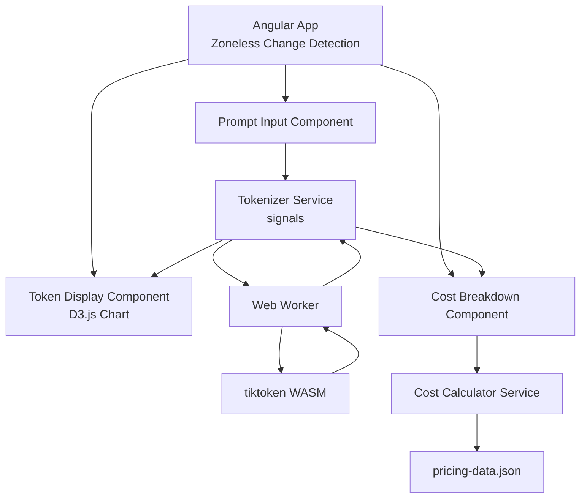

# Token Cost Analyzer (March 2025 - June 2025)

> **Snapshot (2025).** Published in 2026, keeping the stack of the time; not maintained. Limitations: token counts are exact for the OpenAI models and approximate for Claude, Gemini, Llama and Mixtral, and the prices are from March to June 2025. See [Limitations](#limitations).

A client-side application that analyzes tokenization and estimates costs for LLM prompts. It runs the computationally expensive tokenization inside a **Web Worker** using the **tiktoken WebAssembly** module (OpenAI's tokenizer), keeping the UI responsive. Results are visualized with **D3.js** bar charts and a detailed cost breakdown dashboard.

> **100% Client-Side** — No backend, no API calls. All processing happens in your browser. Your prompts never leave your machine.

## Technology Stack

| Layer           | Technology        | Version    |
| --------------- | ----------------- | ---------- |
| Runtime         | Node.js           | 22.14.0    |
| Framework       | Angular           | 19.1.8     |
| Language        | TypeScript         | 5.7.3      |
| Reactive State  | RxJS              | 7.8.1      |
| Visualization   | D3.js             | 7.9.0      |
| Tokenizer       | tiktoken (WASM)   | 1.0.20     |
| Styling         | SCSS              | —          |

## Prerequisites

- **Node.js 22.14.0** (LTS) — download from [nodejs.org](https://nodejs.org/)
- **npm** (included with Node.js)
- A modern browser with WebAssembly and Web Worker support (Chrome 90+, Firefox 90+, Safari 15+, Edge 90+)

## Installation

```bash
# Clone the repository
git clone <repo-url>
cd token-cost-analyzer

# Install dependencies (exact versions pinned in package.json)
npm install
```

## Running the Application

### Development Server

```bash
npm start
# or
ng serve
```

Open [http://localhost:4200](http://localhost:4200) in your browser.

### Production Build

```bash
npm run build
```

The build artifacts will be stored in the `dist/token-cost-analyzer/` directory.

## Usage

### Web Interface

1. **Select a model** from the dropdown (e.g., GPT-4o, Claude 3.5 Sonnet, Gemini 2.0 Flash).
2. **Choose token type** — *Input* or *Output* (output tokens cost more for most models).
3. **Paste your prompt** into the text area.
4. Click **Analyze**.

The dashboard will display:
- **Total token count**
- **Token distribution chart** — horizontal bar chart breaking down tokens by type (words, punctuation, numbers, whitespace, etc.)
- **Cost breakdown table** — model pricing, tokens analyzed, and total cost in USD

### CLI Analysis

You can also tokenize a prompt directly from the command line without opening the browser:

```bash
# Using the shell script
bash scripts/analyze-cli.sh "Your prompt text here"

# With a specific model
bash scripts/analyze-cli.sh "Your prompt" --model claude-3.5-sonnet
```

The script uses `tsx` to run TypeScript directly and prints token count, distribution, and cost estimation.

## Architecture



### Key Design Decisions

- **Web Worker + WASM**: Tokenization with tiktoken is CPU-intensive. By running it in a Web Worker, the main thread stays free for UI updates. No lag, even with large prompts.
- **Zoneless Change Detection**: Angular 19's `provideExperimentalZonelessChangeDetection()` removes Zone.js from the bundle, reducing size (~15 KB) and improving runtime performance.
- **Signal-based State**: All reactive state uses Angular signals (`signal()`, `computed()`, `input()`) for fine-grained reactivity without the overhead of Zone.js.
- **D3.js Directives**: The chart component uses D3.js directly via `ElementRef` with Angular's `afterRender` life-cycle hook for safe DOM manipulation.

## Project Structure

```
token-cost-analyzer/
├── src/
│   ├── app/
│   │   ├── core/
│   │   │   ├── models/
│   │   │   │   ├── token-analysis.model.ts    # TokenAnalysisResult, TokenDistribution
│   │   │   │   └── pricing.model.ts           # ModelPricing interface
│   │   │   ├── services/
│   │   │   │   ├── tokenizer.service.ts       # Web Worker orchestration
│   │   │   │   └── cost-calculator.service.ts # Cost calculation logic
│   │   │   └── workers/
│   │   │       └── tokenizer.worker.ts        # Web Worker (tiktoken WASM)
│   │   ├── features/
│   │   │   ├── prompt-input/                  # Textarea + model selector
│   │   │   ├── token-display/                 # D3.js bar chart
│   │   │   └── cost-breakdown/                # Cost table
│   │   ├── app.component.ts/html/scss         # Root component & layout
│   │   ├── app.config.ts                      # Zoneless + Router + HttpClient
│   │   └── app.routes.ts                      # Route definitions
│   ├── assets/
│   │   ├── pricing-data.json                  # Model pricing (March 2025)
│   │   └── tiktoken_bg.wasm                   # Tokenizer WASM binary
│   ├── environments/
│   │   └── environment.ts
│   ├── index.html
│   ├── main.ts
│   └── styles.scss
├── scripts/
│   ├── analyze-cli.sh                         # Bash CLI wrapper
│   └── analyze.ts                             # Node.js CLI analyzer
├── angular.json
├── package.json
├── tsconfig.json
├── tsconfig.app.json
├── tsconfig.worker.json
└── README.md
```

## Supported Models

| Model               | Input (per 1M tokens) | Output (per 1M tokens) |
| ------------------- | --------------------- | ---------------------- |
| GPT-4o              | $2.50                 | $10.00                 |
| GPT-4 Turbo         | $10.00                | $30.00                 |
| GPT-3.5 Turbo       | $0.50                 | $1.50                  |
| Claude 3.5 Sonnet   | $3.00                 | $15.00                 |
| Claude 3 Opus       | $15.00                | $75.00                 |
| Claude 3 Haiku      | $0.25                 | $1.25                  |
| Gemini 2.0 Flash    | $0.10                 | $0.40                  |
| Gemini 1.5 Pro      | $1.25                 | $5.00                  |
| Llama 3.3 70B       | $0.59                 | $0.79                  |
| Mixtral 8x22B       | $0.24                 | $0.24                  |

*Pricing reflects market rates as of March–June 2025.*

## Limitations

- **Token counts are exact only for the OpenAI models.** The worker (`src/app/core/workers/tokenizer.worker.ts:16-29`) and the CLI (`scripts/analyze.ts`) use each OpenAI model's own encoding: `o200k_base` for GPT-4o and `cl100k_base` for GPT-4 Turbo and GPT-3.5 Turbo. Claude, Gemini, Llama and Mixtral have tokenizers of their own, which tiktoken does not include, so they are counted with `cl100k_base`: their token counts, and the costs built on them, are approximations.
- **The prices are frozen.** `src/assets/pricing-data.json` holds the list prices from March to June 2025 and is not updated; check each provider's current pricing before relying on a figure.
- **There are no tests.**

## License

This project's code is licensed under the [MIT License](LICENSE).

## A note on the commit history

This repository was published in 2026 as a curated reference of work originally designed and prototyped between March 2025 - June 2025. The technology stack reflects the versions available during that development window and has been intentionally preserved for historical accuracy.
